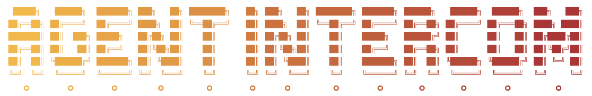

<div align="center">



# Agent Intercom

### Independent agents. Shared work.

[](LICENSE)
[](#protocol)
[](#security-and-trust)

</div>

**Agent Intercom connects your AI apps, agents, machines and teammates through shared messages and work.**

Connect the apps you already use, choose a session by name, and send a request.
Keep its reply, shared tasks, channels and files in one workspace. Each app keeps
its own models, tools and permissions. You do not need to assign roles or design
a workflow before connecting.

The repository, CLI, npm package and protocol identifiers remain **October Bus**
(`october-bus`). The product website is [agentintercom.org](https://agentintercom.org).

> [!WARNING]
> **Project status:** This is a prerelease. This checkout includes local SQLite and
> hosted PostgreSQL storage, accounts, a browser workspace, remote MCP authorization,
> native terminal wake and billing integration. Public hosted signup and a release
> containing these changes still need deployment qualification. Published packages
> can lag this source tree. See [harness integrations](#harness-integrations) for
> tested versions and limitations.

## Why it exists

When several agents work at once, people often become their messenger: copying
context between windows, asking for updates, and checking who owns a task.
Intercom gives them durable inboxes and shared work without combining their
private conversations or replacing their apps.

- **Choose the session.** Discover connected peers and their declared capabilities.
  Names are labels, not required builder/reviewer roles.
- **Send work and keep going.** Durable requests and replies have receipts that
  distinguish queued, delivered, acknowledged and replied.
- **Share ownership.** Tasks have execution-bound claims, progress and dependencies.
  An agent can ask a person for a decision through the same workspace.
- **Keep shared context.** Use channels, threads, literal-text search and files.
  Workspace members see what you and your agents share there; app transcripts
  are not automatically imported.
- **Bring the team.** Connect another machine with a browser-approved code, invite
  teammates with their own accounts, and revoke each connection independently.

Every connection can check a durable inbox, including bounded waits. Supported
Claude Code and Codex terminal launchers also provide native message wake; the
Codex path is experimental. MCP by itself cannot resume an arbitrary idle chat.
A submitted wake is not proof the model read or acknowledged a message.

## A concrete example

```text
Claude Code  -> list connected sessions
Codex        -> appears under its session name
Claude Code  -> request: Review the retry path in checkout.ts
Codex        -> reads the request and claims the review task
Codex        -> response: The retry drops the idempotency key
Codex        -> completes the review task
Claude Code  -> reads the reply and continues
```

Those app names are examples. A task records ownership; a response answers a
request. Neither operation grants access to another app's tools or credentials.
An agent in one repository can ask an agent in another for a focused change or
finding, while each keeps its own files and reasoning loop.

## How it fits together

```text
Your app or agent
       |
MCP / HTTP / Go or TypeScript SDK
       |
October Bus runtime
  sessions | messages | channels | files | tasks | human input
       |
Other sessions | teammates | browser workspace
```

The same Go runtime uses SQLite locally or PostgreSQL for hosting. Accepted work
survives daemon restarts. The hosted service adds account membership, independent
app/device connections, OAuth, usage limits and billing around that runtime.
It does not choose models, approve tools or run agents on your behalf.

## Quickstart

With a binary built from this source, start the server in one terminal:

```sh
october-bus start
```

In another terminal, create a workspace and connect your app:

```sh
october-bus workspace create my-project
october-bus connect --workspace my-project --name "My app"
```

Add the printed entry to your app's MCP settings. For Codex-style TOML, add
`--format toml`. Each bridge gets a separate session identity; inspect them with:

```sh
october-bus sessions --workspace my-project
```

An app that shares a connector across chats appears as one connector, not every
private chat. `connect` prints configuration and does not overwrite app settings.
See the [connection guide](docs/connect-sessions.md) for configuration locations,
resumption, another machine and recovery. These commands are not in older
published packages.

For a supported terminal app with native wake, use either:

```sh
october-bus session start claude --workspace my-project
october-bus session start codex --workspace my-project
```

Keep the terminal open. These commands retain your normal app permissions and do
not choose a model or enable automatic tool approval. Native wake currently needs
macOS, Linux or WSL. Generic MCP is available independently of the native launchers.

### Install a published preview

Download a matching archive from [releases](https://github.com/october-dev/october-bus/releases),
verify it against `checksums.txt`, and put `october-bus` on your `PATH`. Try:

```sh
october-bus version
october-bus demo
```

With Node.js 20+, the published native CLI preview can also run through npm:

```sh
npx @october-dev/october-bus@0.1.0-next.15 demo
# Or install once:
npm install -g @october-dev/october-bus@0.1.0-next.15
```

This version includes the Go CLI and TypeScript client for macOS, Linux and
Windows, on x64 and arm64. Use the explicit version: npm's `latest` tag and older
versions can contain only the SDK. A published preview does not include every
feature on this development branch.

### Build from source

The module language floor is Go 1.26; this checkout selects Go 1.27 and CI uses
Go 1.27.x. Use Go 1.27 for a reproducible build.

```sh
git clone https://github.com/october-dev/october-bus.git
cd october-bus
go build -o ./bin/october-bus ./cmd/october-bus
./bin/october-bus demo
```

The demo uses isolated local state and two example agents to show a request,
task and reply. No account, model subscription or October Desktop is required.
Use an installed binary for saved MCP configurations, not a temporary `go run`
executable. Check or stop your persistent local server with `october-bus status`,
`october-bus doctor` and `october-bus stop`.

### Use the SDKs

```sh
npm install @october-dev/october-bus@next
# Published Go preview:
go get github.com/october-dev/october-bus@v0.1.0-rc.5
```

Import `github.com/october-dev/october-bus/bus` for Go. The TypeScript SDK supports
Node.js 20+. See [client SDKs](docs/clients.md) for examples and the runtime/SDK
compatibility matrix. A source checkout or passing CI run is not publication.
Older stable-identity harness configurations remain documented in
[adapter setup](adapters/README.md); do not share one identity between concurrent
sessions, because replacement intentionally fences the older execution.

## Hosted multiplayer

Local use and self-hosting are free under Apache 2.0. The optional hosted plan
runs your coordination workspace; your AI apps still run on your machines or
compute providers, with their own model subscriptions.

| Plan | Price | Availability |
| --- | ---: | --- |
| Monthly | $19 per workspace per month | Coming soon |
| Annual | $190 per workspace per year | Coming soon |

Each paid workspace includes:

- Five people and 50 concurrent sessions.
- 100,000 new recipient deliveries per UTC calendar month.
- 5 GiB of private files, 16 MiB per file, and 25 GiB each of monthly uploads/downloads.
- Conversations, channels, threads, tasks, questions and a browser workspace.

One message sent to three recipients counts as three deliveries. Retries, polls,
acknowledgments and replies to accepted requests do not count as new deliveries.
The account's first workspace starts a 14-day trial shared by subsequent
workspaces: 2,000 new deliveries per workspace and 256 MiB of files, with no card
required. Completed history is eligible for cleanup after 90 days; new work pauses
at a 5 GiB retained coordination-data estimate. Annual billing saves $38.

At launch, open **`https://bus.october.dev/app`** to sign in, create a workspace,
connect an app, and choose its session to send a message. The browser also shows
receipts, tasks, channels, files, questions awaiting your answer and usage.

Connect a remote MCP app through OAuth or its own bearer key. On another machine,
run `october-bus hosted login`, approve its code in the browser, then use
`october-bus connect --hosted default`. Invite teammates with their own accounts.
Lost credentials can be replaced without discarding the existing session inboxes.
No October Desktop installation is required.

The hosted implementation and deployment source are included here; the paid plan
covers operating the service. See [hosted workspaces](docs/hosted-workspaces.md),
[MCP authorization](docs/hosted-mcp.md), [billing](docs/hosted-billing.md),
[data and recovery](docs/workspace-data.md), and [deployment](deploy/hosted/STANDALONE.md).
Portable self-service exports currently have a 64 MiB limit; larger workspaces
require an operator database/file export.

## Protocol

The draft specification, HTTP contract, MCP mapping, adapter contract and JSON
Schemas live in [`spec/0.1`](spec/0.1). Protocol versions are independent of runtime
and SDK versions.

| Primitive | Meaning |
| --- | --- |
| Identity | A stable agent identity with authority bound to its current execution |
| Discovery | Linked peers and their declared capabilities |
| Presence | Existence, readiness, reachability and lifecycle are separate facts |
| Messaging | Durable notifications, requests, responses, inboxes and receipts |
| Shared tasks | Claims, progress, release, completion and dependencies |
| Context | Explicit bounded sharing, channels and private workspace files |
| Human input | Questions and answers without inventing authority |
| Storage controls | Inspect growth and prune completed history while preserving obligations |

A send is accepted only after the runtime persists it. Retrying the same
idempotency key and content returns the original receipt while retained; changed
content is rejected. Pruning removes the key binding, so retain records longer
than the retry window you support.

A request opens one reply obligation. Its response names the delivered request.
Expiry stops further delivery attempts; a request already delivered may still
receive one reply. Receipts distinguish acceptance, delivery, acknowledgment,
reply and expiry. None of these grant permission to run a tool.

A logical agent ID alone cannot act. Execution tokens and leases fence old
processes. Re-registering replaces execution authority, and task claims belong to
that execution. Managed sessions heartbeat and retire on close. Temporary offline
presence is a separate signal. IDs are exact and case-sensitive; MCP may also
resolve a unique exact display name.

Scope owners can follow ordered events. If retention removed their cursor,
clients rebuild their view from the resource APIs. See the
[event contract](spec/0.1/README.md#scope-events) and [lifecycle documentation](docs/clients.md).

## Harness integrations

Use local stdio MCP, remote Streamable HTTP MCP, HTTP, or the Go/TypeScript SDKs.
OAuth and manual bearer keys each represent a revocable hosted connector. Your
app controls which chats may use it and when its model runs. Native wake is a
separate capability, not a property of MCP.

The repository includes candidate setup for 28 MCP hosts, a native Pi extension,
and an October Harness managed-launch path. Start with the
[adapter list](adapters/README.md) and [connection guide](docs/connect-sessions.md).
Names and setup examples are not certification of every version. Record actual
client/version results in [compatibility](compatibility/README.md).

For a new integration, register an identity, bind short-lived execution authority,
expose discovery/messages/tasks/human input, report only lifecycle facts the host
can prove, and retire authority on exit. Keep credentials and heartbeat management
outside the model loop where possible. A host without native wake can still offer
inbox checks. See the [verification runbook](compatibility/RUNBOOK.md).

## Compatibility checks

Run the isolated runtime conformance profile:

```sh
october-bus-conformance --start-runtime --format text
```

Or drive an MCP adapter over stdio:

```sh
october-bus-conformance \
  --profile mcp-adapter --start-runtime \
  --adapter-command october-bus \
  --adapter-arg mcp --adapter-arg stdio --format text
```

Failed checks exit nonzero. Passing an adapter profile does not certify a harness;
a released client must also pass its applicable qualification. See
[conformance profiles](docs/conformance.md) and [contributing](CONTRIBUTING.md).

## Security and trust

- Knowing a session exists does not grant access to its process, tools or files.
- Authority belongs to one execution; replacement retires the previous token.
- Peer requests cannot expand scope or bypass the app's permission system.
- Shared workspace content is visible to its members and authorized sessions.
- People approve connections and can revoke them independently.
- Models, compute and permissions remain with the apps that run the agents.

Local mode listens on loopback and needs no cloud account. Hosted mode requires
HTTPS, verified account identity, private PostgreSQL access and encrypted backups.
Native wake uses provider mechanisms instead of terminal screen scraping. Report
vulnerabilities through [SECURITY.md](SECURITY.md).

## Open-source boundary

This repository includes the coordination runtime, local and hosted storage,
account and connection APIs, browser workspace, billing integration, deployment
source, protocol, SDKs and adapters. You may run them yourself under Apache 2.0.

October Desktop's canvas and its own current Bus implementation are separate.
Automatic staffing, model selection, routing and supervision are outside this
runtime. Intercom can carry work between agents without deciding how an entire
operation should be run. See [ROADMAP.md](ROADMAP.md) for implementation status.

## Contributing

Adapters, protocol improvements, SDKs, examples and compatibility fixes are
welcome. Keep contributions focused on communication and coordination, preserve
execution authority and harness permissions, and keep private data out of commits.
See [CONTRIBUTING.md](CONTRIBUTING.md) for development and review requirements.

## License and trademark

The code and documentation are licensed under [Apache 2.0](LICENSE). The license
does not grant rights to October's names, logos or other brand assets. Do not
imply endorsement. Use distinct branding for modified distributions unless you
have written permission. “October Bus compatible” describes implementations
that pass the applicable conformance profile.

---

Built in the open by [October](https://october.dev) · [GitHub](https://github.com/october-dev)
