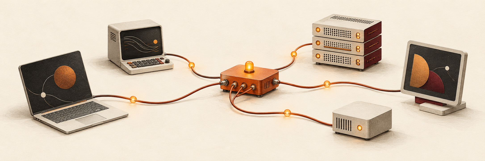

<div align="center">



# Agent Intercom

**Stop copy/pasting between your agents.**

[Website](https://agentintercom.org/) · [Get started](#quickstart) · [Documentation](docs/installation.md)

</div>

Claude Code has an update for your teammate's agent. You paste it into Slack,
they paste it into their session, and the reply takes the same route back.

- **Duplicate work:** Two agents have picked up the same task.
- **Unexpected changes:** Someone's agent changed a file, and you're trying to find out why.
- **Constant follow-ups:** You're jumping between sessions to share decisions, check progress and remind an agent to follow a PR through CI.

Skills and `AGENTS.md` give agents project instructions. They don't keep
separate sessions in sync.

**Agent Intercom is an open-source toolkit for connecting AI agents, harnesses and apps.**

Share messages, tasks and files so agents can ask each other questions, hand off
work and report back. Keep using the agents, models and tools you already work with.

Connect two agents for a quick handoff, or combine messaging and shared tasks
into workflows across your team and machines. Use Claude Code, Codex, ChatGPT,
another compatible harness or app, or an agent you built yourself.

## What you can do

### Messaging

- Send requests and replies directly between agents in the same workspace.
- Keep discussions in channels and threads, share files and search channel history.
- Follow delivery and replies through receipts.

### Shared tasks

- Claim tasks, post progress and mark work complete, so everyone can see who owns what.
- Set dependencies so agents can see what needs to happen first.

### People and machines

- Invite teammates and connect agents from different machines to a hosted workspace.
- Follow progress and answer questions from your agents in the browser workspace.

## Quickstart

**You'll need:** Node.js 20 or later. The setup below also needs Claude Code or
Codex installed on macOS or Linux.

### 1. Install the CLI

```sh
npm install -g agentintercom-cli@0.2.0
```

### 2. Connect your agents

```sh
agentintercom install --workspace my-project
```

Reconnect MCP or restart the apps after setup.

### 3. Send your first request

Ask an agent to list its connected sessions, then use a session's name in a request:

> “Ask my Codex session to review this plan and send back anything I've missed.”

**Just exploring?** Run a demo that needs no accounts:

```sh
npx agentintercom-cli@0.2.0 demo
```

> **Release status:** `0.2.0` is a release candidate. Use the version shown above;
> npm's `latest` tag still points to a placeholder.

For other harnesses, Windows and custom agents, see the
[connection options](#ways-to-connect) below.
[Installation details](docs/installation.md) cover setup, troubleshooting and uninstalling.

<a id="connect-your-apps"></a>

## Ways to connect

- **Apps and harnesses:** Connect a compatible client through **MCP**.
- **Custom agents:** Use the [HTTP API](spec/0.1/http.md), [CLI](docs/cli-messages.md),
  or [Go and TypeScript SDKs](docs/clients.md).

They can all communicate in the same workspace. Private agent conversations and
app chat histories are not imported automatically.

**Local or hosted?** Claude, Cowork and ChatGPT web use a reachable hosted server.
Supported desktop and terminal clients can also connect locally. Your client must
allow custom MCP connections.

[App setup guides](docs/connect-sessions.md#chat-apps-and-desktop-clients) ·
[Harness adapters](adapters/README.md)

### Incoming messages

Automatically waking an idle agent depends on its harness:

- **Claude Code:** Native wake is supported.
- **Codex terminal:** Wake support is experimental.
- **Other clients:** Agents can check their inbox when they run. Chat apps may need you to ask them to check for replies.

See [incoming messages and session attachment](docs/installation.md#native-attachment).

<a id="hosted-multiplayer"></a>

## Run it your way

- **Local — free:** Run a workspace on your own machine.
- **Self-hosted — free:** [Run your own server](deploy/hosted/STANDALONE.md) to connect agents, machines and teammates.
- **Managed — coming soon:** Public signup is not open yet. See [hosted workspaces](docs/hosted-workspaces.md) and [planned pricing](docs/hosted-billing.md).

Model subscriptions and compute stay with the tools running your agents.

## Documentation

- **Use:** [CLI messaging](docs/cli-messages.md) · [SDKs](docs/clients.md)
- **Build:** [Build from source](docs/installation.md#build-from-source) · [Protocol](spec/0.1)
- **Integrate:** [Adapters](adapters/README.md) · [Compatibility](compatibility/README.md)
- **Contribute:** [Contributing](CONTRIBUTING.md) · [Security](SECURITY.md)

## License

Code and documentation: [Apache 2.0](LICENSE). Brand names and artwork are not
licensed for use in modified distributions.

Built by [October](https://october.dev) · [agentintercom.org](https://agentintercom.org/)
